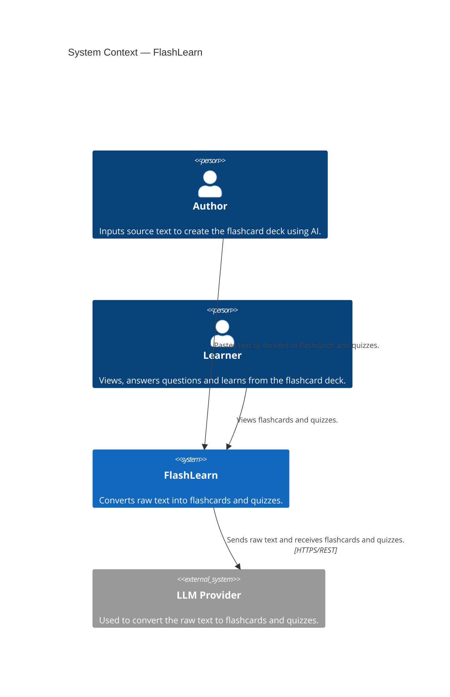

# FlashLearn — C4 Level 1: System Context

> **What this shows:** who interacts with FlashLearn and the external systems it
> depends on. FlashLearn is a single opaque box here — internal structure
> (React, Spring Boot, Postgres) belongs in Level 2 (Container).

