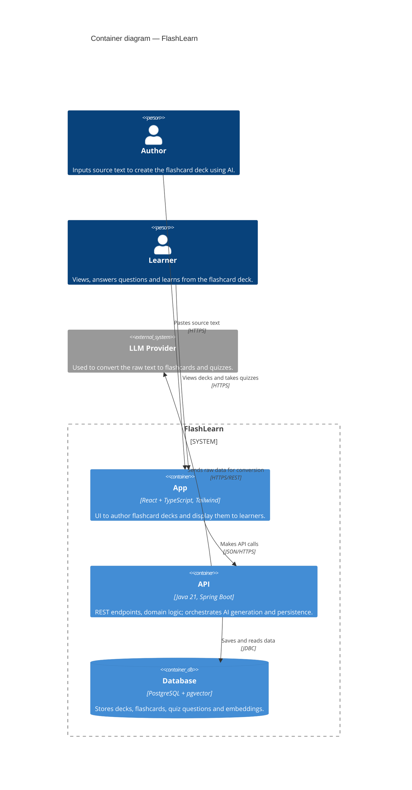

# FlashLearn — C4 Level 2: Container

> **What this shows:** the major building blocks *inside* FlashLearn — each a
> separately runnable app or data store — their technologies, and how they
> communicate. Actors and the LLM carry over from Level 1. Internal class/
> component detail belongs in Level 3 (Component).

