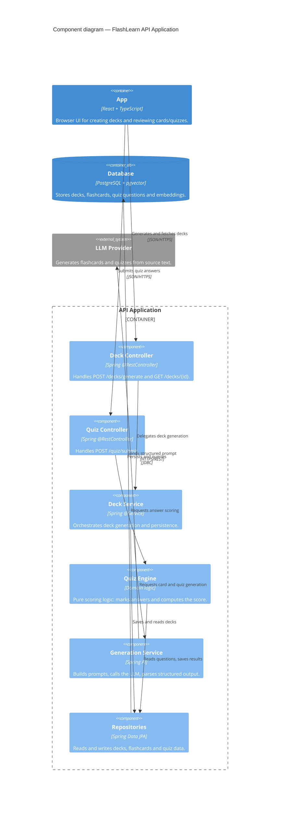

# FlashLearn — C4 Level 3: Component (API Application)

> **What this shows:** the internal components of the **API Application**
> container and how a request flows through the layers
> (Controller → Service → Repository). The SPA, Database and LLM stay as
> context boxes — they are not opened up at this level.

